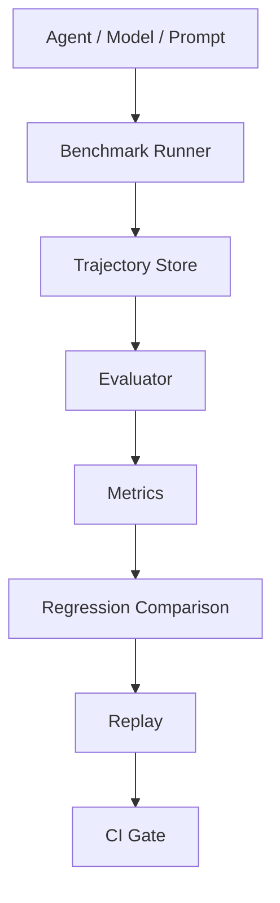

# Agent Evaluation, Replay & Regression Infrastructure

Run agents against benchmark and production workloads, capture trajectories, replay
failures, compare agent/model/prompt versions, detect regressions, and enforce
quality gates in CI. The product is the evaluation and control plane around agents.



## Five-minute offline benchmark demo

Python 3.10+, Linux/macOS, no runtime dependencies or API keys:

```sh
pip install -e .
agent-replay benchmark run --benchmark local \
  --suite examples/benchmarks/terminal-smoke --agent demo \
  --output .replay/benchmarks/baseline
agent-replay benchmark run --benchmark local \
  --suite examples/benchmarks/terminal-smoke --agent demo-v2 \
  --output .replay/benchmarks/candidate
agent-replay benchmark compare \
  .replay/benchmarks/baseline .replay/benchmarks/candidate
agent-replay benchmark report .replay/benchmarks/candidate \
  --baseline .replay/benchmarks/baseline
```

Expected: **2/4 → 3/4**, with **2 newly passing and 1 newly failing task**.
Overall improvement still contains a regression; the default gate catches it:

```sh
# Expected exit 1: one new regression.
agent-replay benchmark gate \
  --baseline .replay/benchmarks/baseline --candidate .replay/benchmarks/candidate
# Explicit tolerance for this synthetic demo: expected exit 0.
agent-replay benchmark gate \
  --baseline .replay/benchmarks/baseline --candidate .replay/benchmarks/candidate \
  --max-new-failures 1 --max-success-drop 0 --max-cost-increase 0
```

Each run stores metadata, per-task results, existing trajectory v2 files and
JSON/HTML/JUnit reports. Open `.replay/benchmarks/candidate/reports/index.html`.
Failed trajectories work with the existing inspect/replay/debug workflow.
Use fresh output directories when repeating the demo.

**Implemented:** local adapter, deterministic demo agents, evaluation, metrics,
task/tag regressions and CI gates. **Experimental:** optional OpenAI-compatible
agent. **Planned:** Terminal-Bench, SWE-bench, tau-bench, OSWorld, WebArena and
trajectory-prefix failure prediction. Those adapters and ML features are not implemented.
Local execution runs trusted code in fresh working directories, not a security sandbox.

See [benchmark formats, extension points, replay, metrics, CI and roadmap](docs/benchmarks.md).
The existing replay, regression, rollout and training features remain available below.

---

## Distributed RL Rollout & Replay Infrastructure


Ray / process Actor workers → versioned trajectories → independent rewards → replay/debug → real policy updates. Includes a CPU-only REINFORCE demo and preserves the Agent Regression Debugger.

```sh
pip install -e .
agent-replay rollout demo --actors 3 --rounds 8
```

New in v0.4: [DDP/GRPO, vLLM, async scheduling, storage, recovery and benchmark guide](docs/distributed-training.md). GPU execution and Kubernetes deployment remain unvalidated without a GPU environment.

See [rollout architecture, API, workers and scope](docs/rollout-infrastructure.md). The Vercel site displays recorded/imported evidence; the controller and workers run on your infrastructure. This release uses one SQLite controller. Ray GPU reservations and a GRPO learner are implemented; GPU execution and controller high availability are not validated.

---

# Replay — Agent Regression Debugger

[Live workspace](https://agent-replay-debugger.vercel.app) · [Implementation guide](docs/implementation.md) · [Original implementation plan](docs/agent-regression-debugger-plan.md)

**Turn a production agent failure into a regression test.**

Capture the input and model/tool boundaries, rerun trusted agent code with controlled observations, compare model/tool/code changes, and verify business assertions in CI. Python 3.10+, MIT, no runtime dependencies. Package version 0.2.0; the package has not been published to PyPI.

## A working failure → fix → regression story

```bash
python -m pip install -e .
agent-replay demo --directory .replay/demo
agent-replay serve --project .replay/demo/agent-replay.json
```

Open **http://127.0.0.1:8765**. The demo actually runs an agent that refunds 299.00, a fixed agent that refunds 29.00, then the original bug again. Assertions require one refund, the correct order, completed execution, and at most 30.00. The results are **fail → pass → fail**. All payments and model responses in the demo are synthetic; there are no external calls.

The UI provides Failures, paired boundary comparison, Regression CI results, and setup. The hosted site works with imported JSON and exported reports; local execution needs the Python runner. The previous single-step debugger remains at `/legacy.html`.

## Capture a production boundary

```python
from agent_replay import capture, tool

@tool(boundary_id="orders.lookup", side_effect="read")
def lookup(order_id):
    return your_lookup(order_id)

with capture("refund-agent", input={"order_id": "1042"}, durability="sync") as run:
    result = your_agent(run)
    run.set_output(result)
    if result["amount_minor"] > 3000:
        run.fail("Refund exceeds approval", category="assertion")
```

A completed execution can still violate a business rule. v2 captures persist journals at boundaries; `recover` reads a valid prefix after interruption. v1 capture and the original `replay_step`/`replay_agent` SDK APIs remain compatible. New `async_replay_agent` is awaitable in an active event loop.

## Run, compare, and test

Register a trusted `agent(run)` entrypoint in `agent-replay.json`; see the [configuration guide](docs/implementation.md).

```bash
agent-replay inspect failure.json
agent-replay doctor failure.json --project agent-replay.json --entrypoint refund
agent-replay run failure.json --project agent-replay.json --spec replay-spec.json
agent-replay compare failure.json candidate.json --output comparison.json
agent-replay case create failure.json --entrypoint refund --output tests/agent_cases/refund.case.json
# Add reviewed business assertions and explicit fixtures to the draft.
agent-replay test tests/agent_cases --project agent-replay.json --report-dir .replay/reports
```

Reports include JSON, JUnit XML, and standalone HTML. Default CI has no live model calls. A recorded single step cannot make a regression suite pass. Changed/ambiguous inputs stop instead of silently executing real tools. Baselines are accepted explicitly; the original failure is preserved.

Cross-model experiments support non-streaming OpenAI-compatible Chat Completions and native Anthropic text/tool Messages through registered providers. Tool replacements use registered local implementations. `run --commit REF` actually executes a separate detached worktree with a prepared environment. Live models remain nondeterministic and are opt-in; environment/coverage gaps stay visible.

## Guarantees and limits

- Explicit instrumented boundaries, not automatic capture of every library call.
- From-start execution, not process checkpoint resume. Trusted project code still runs normally.
- No real-tool fallback after a mismatch. Frozen outputs are not proofs of business correctness.
- Checksummed data bundles, best-effort credential redaction, and user redactors. Not complete PII detection.
- Same-origin loopback API with a session token, one worker, persisted jobs and cancellation.
- Static hosted UI does not run Python, receive local traces automatically, or store API keys.
- Provider tests use local mock servers; real paid-provider integration and production workload overhead need environment-specific validation.

## Development and packaging

```bash
python -m pip install -e '.[dev]'
python -m unittest discover -s tests -v
node --test tests/*.test.mjs
python scripts/package_release.py
python scripts/package_release.py --check
```

`dist/` is the canonical web source. Packaging synchronizes `sdk/agent_replay/web`, public schemas, and the self-contained plugin vendor. Do not edit generated copies. The deterministic source ZIP excludes user traces, credentials, environments, and recursive archives. GitHub workflows run SDK/web tests, the fail/pass/fail story, regression reports, and wheel/plugin smoke checks.

Vercel serves `dist/` as a static site using `vercel.json`. Backend execution stays in the local runner.
