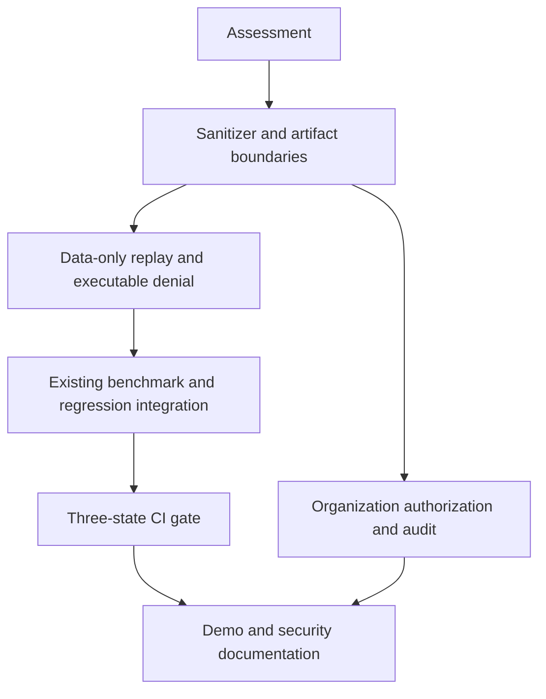

# Security gap analysis and execution plan

Assessment baseline: main `6c9fa59b009e606aa1db845d0e4d6bc76980da24`,
2026-10-11. Benchmark implementation in open PR #2 (`f8c43e6`) is not on main.
No AGENTS.md was present in the inspected repository tree.

## Existing architecture and reuse inventory

| Capability | Classification | Evidence / gap |
| --- | --- | --- |
| Capture SDK | Existing but incomplete | capture.py has explicit sync/async spans, context parents, journal, v2 conversion; custom redactor does not cover every path |
| Schemas / atomic file storage | Existing and reusable | contracts.py, migrations.py, storage.py, schemas/; v1/v2 compatible; generic save does not sanitize |
| Credential redaction | Existing but incomplete | schema.sanitize uses a small key list and two text patterns; no policy, PII option, path metadata or fail-closed converter |
| Durable capture | Existing and reusable | journal.py checksummed records and recovery; append accepts raw payload |
| Export / import | Requires refactoring | bundle.py exports original file bytes; imported historical traces may contain secrets |
| Single-step replay | Existing but incomplete | replay.py recorded/fixture modes; live/tool options invoke host code/transport |
| Whole-agent replay | Requires refactoring | experiments.py inherits os.environ; runtime.runner invokes entrypoint; decorators do not intercept raw I/O |
| Sandbox boundary | Missing | worker timeout/process group is not network/filesystem/credential isolation |
| Regression assertions / reports | Existing and reusable | regression/, comparison/ use business assertions and structural diffs; execution availability must be separated from verdict |
| Benchmark adapter / metrics / gate | Existing in unmerged PR #2 | Reuse PR #2 rather than adding a second evaluation pipeline |
| Training / rollout | Existing and reusable | rollout/ SQLite controller, role capabilities, workers; separate trusted training plane, not a sandbox or multi-tenant service |
| CI | Existing and reusable | GitHub Actions unit, regression, rollout, distribution and optional training checks |
| HTTP security | Existing but incomplete | server.py loopback host/origin validation and local mutation token; reads unauthenticated, token disclosed by health |
| Organization RBAC | Missing | No server-derived organization principal or tenant-scoped artifact root |
| Audit trail | Missing | Capture journal is execution evidence, not an access/security audit trail |
| Retention | Existing but incomplete | retention.py deletes standalone traces only; journals/derived results remain |
| UI security disclosure | Missing | Existing dashboard has trace/replay/regression pages; extend those |

## Proposed changes and dependencies

Use additive privacy metadata on existing trajectories, a shared sanitizer at
capture and artifact boundaries, and a data-only replay capability with no imported
entrypoint or executable callbacks. Do not try to secure arbitrary Python through
monkeypatching socket/open. SANDBOX_REPLAY and MODEL_RERUN will fail closed until an
independently verified isolation backend is available. TRACE_PLAYBACK can reconstruct
sanitized observations but is not evidence that modified agent code works.

Reuse PR #2's benchmark package on top of latest main. Add paired statistical
summaries and explicit PASS/FAIL/INCONCLUSIVE release policy there. Implement an
opt-in authenticated pilot mode on the existing HTTP handler, with token-derived
organization roots and ADMIN/DEVELOPER/VIEWER authorization. Keep local desktop mode
explicitly single-user; do not market it as tenant isolation. Keep trusted rollout
training separate and do not expose it through the pilot server.

## File-level plan and prioritized checklist

- [x] P0: add security/sanitizer.py; update schema.py, capture.py, journal.py,
  storage.py, bundle.py and response/export boundaries; add tests/test_security_privacy.py.
- [x] P0: add security/replay.py; update replay.py, experiments.py, runtime/runner.py,
  runtime/policy.py, runtime/fidelity.py and CLI dispatch; add hostile-callback/no-network tests.
- [x] P1: reuse benchmark/ from PR #2; extend compare.py, reports.py and gate CLI
  with uncertainty, severity, version identity and replay limitations.
- [x] P1: extend GitHub Actions with a synthetic security demo and blocking gate.
- [x] P1: add security/access.py and server-side tenant routing, RBAC and audit;
  extend CLI serve configuration and add cross-tenant HTTP tests.
- [x] P2: add organization-wide artifact retention including journals/derived data;
  document audit and backup limitations.
- [x] P1: update dist/dashboard.js, existing report page, README and docs/security/;
  synchronize web/plugin distribution using scripts/package_release.py.

## Migration and compatibility

No PostgreSQL exists. No SQL/RLS migration is required for the file-backed pilot.
Organization roots are new namespaces; historical files are not silently assigned
to an organization. Administrators must explicitly sanitize/import their data.
Rollout SQLite remains unchanged and outside tenant service scope.

v1/v2 trajectory fields remain readable. Privacy/security metadata is additive.
The intentional security break is removal of host execution from replay: live
single-step calls, local tool functions and whole-agent code reruns cannot claim
safe reproduction. They must reject before importing code or acquiring credentials.
Existing production capture and explicitly initiated benchmark/training execution
remain real execution and are not replay isolation. Regression cases that require
unavailable execution must become inconclusive, never silently pass from playback.

## Risks and verification

Pattern detection cannot discover every unknown secret. Structured rules, custom
fields, optional PII and conservative converter failure handling reduce exposure;
upstream minimization remains required. Arbitrary application stdout is not captured
or controlled by this SDK. Historical plaintext needs explicit migration; sanitized
export must not copy original bytes. No automatic secret reconstruction.

Data-only replay has no callable tool/agent interface; unknown/missing/redacted
observations fail closed for reusable mocks. Playback can still inspect redacted
history with explicit limitations. Model reruns are nondeterministic and unavailable
in safe replay until isolated provider access is designed.

Tests per phase: persisted canary scans (including journal/export/error paths),
converter failures and nested structures; hostile email/payment/database/cloud/
file/shell/network/credential callbacks; benchmark/task gate boundaries; real HTTP
RBAC/cross-tenant access; retention of derived artifacts; synthetic end-to-end demo.
Run existing tests and distribution checks; document changed security expectations
rather than retaining unsafe behavior solely to satisfy a legacy test.

## Implemented phase results

| Phase | Modified areas | Verification / limits |
| --- | --- | --- |
| 0 | This assessment | Inspected current main and open PR #2 before implementation |
| 1 | security/sanitizer, capture, schema, journal, storage, bundle, serialization, report/response and rollout artifact sinks | Persisted canaries, nested/encoded data, metadata, malformed/custom failure tests pass; unknown opaque secrets remain a documented detection limit |
| 2 | security/replay + CLI, replay, experiments, runtime policy/runner/fidelity | Mock/playback has no code-execution capability; dangerous callbacks rejected; sandbox unavailable and disabled |
| 3 | Existing regression runner/cases/demo; reused PR #2 benchmark contracts/metrics/compare/reports + release.py | Synthetic fail/pass/fail remains; candidate evidence is checksum-bound; paired statistics and structural failure analysis covered |
| 4 | benchmark gate/report CLI, security-reliability workflow | Explicit PASS/FAIL/INCONCLUSIVE, blocking policy, JSON/HTML/JUnit evidence; deployment/branch protection remains operator configuration |
| 5 | security/access, existing server/serve CLI, dashboard and legacy import behavior | Real HTTP tenant isolation/viewer denial/audit/retention tests; file-backed pilot, no SSO or remote deployment claim |
| 6 | security/demo, docs/security, README, package sync | Synthetic model A/B canary + mutation interception + playback + critical regression FAIL; no paid provider calls |

Legacy tests relying on unsafe host replay now assert denial. The original benchmark,
rollout, schema, capture, comparison and regression assertion coverage is retained.
The refund demonstration evaluates separately captured synthetic candidates rather
than pretending recorded playback tests modified code. This is an intentional safety
compatibility change, not a successful implementation of executable sandbox replay.
