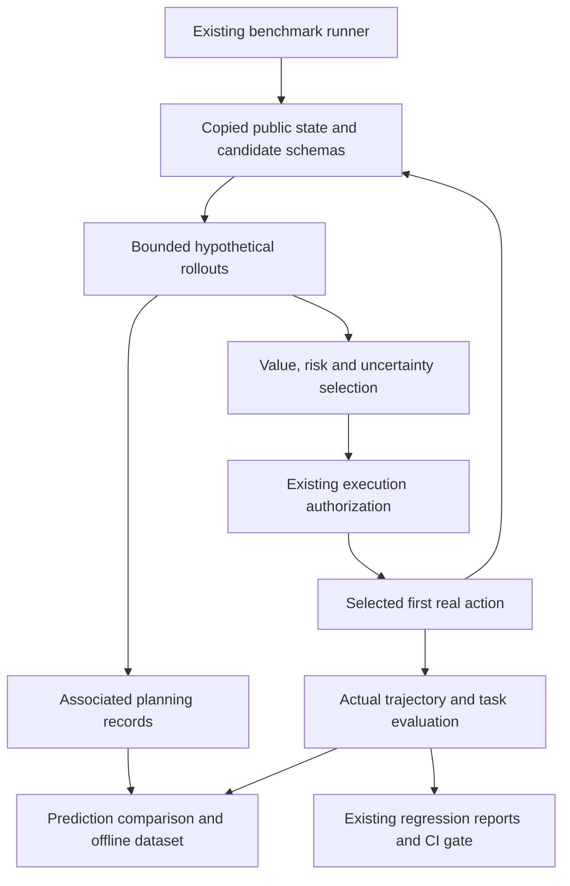

# Predictive planning extension: audit and implementation plan

Assessed 2026-10-17 against self-service PR #5 (`29e7ad4`), not against an imagined
architecture. Main remains `6c9fa59`; benchmark/security/guard/self-service work is
on stacked branches. This extension builds on that tested source tree.

## Inventory and integration points

| Capability | Actual implementation | Incremental change |
| --- | --- | --- |
| Execution | `runtime/runner.py` denies host replay; `benchmark/runner.py` invokes `BenchmarkAgent.run(task, environment, capture)` | Keep host denial. Add opt-in PlanningAgent implementing the existing protocol |
| Benchmark | `benchmark/contracts.py`, `adapter.py`, local file/verifier adapter, RunStore | Add a trusted in-memory deployment adapter; preserve local adapter and result format |
| Trajectory | `capture.py`, v1→v2 migrations, `contracts.validate_v2`, JSON schemas | Optional `metadata.planning` associated records, actual tool step correlation; no new step kind |
| Persistence | Atomic sanitized `storage.save/read/within`, file-backed benchmark and regression artifacts | Versioned planning-session and transition-dataset records, same sanitizer/store |
| Replay | Data-only `security/replay.py`, recorded mocks; executable replay disabled | Preserve sessions in metadata through playback; expose simulated/actual comparison |
| Comparison/gates | `benchmark/compare.py`, `release.py` paired statistics, three-state gate | Add planning metric comparisons and a planning policy extension to existing gate |
| Metrics/reports | `benchmark/metrics.py`, JSON/HTML/JUnit reports | Optional planning distributions and calibration summaries, same reports |
| Providers | `providers/registry.py` dispatches OpenAI-compatible/Anthropic transports | Optional bounded predictor process reuses registry; no provider code in planner |
| API/UI | Python `/api/v1/`; vanilla `dashboard.js`; Node SaaS project API and `guard-ui.js` | Mock-only simulate endpoint, session reads, reusable candidate/outcome view in existing details |
| Accounts/database | Better Auth + Node SQLite; Python artifacts separate from rollout SQLite | No account/ORM/database migration |
| Tests/hosting | unittest, Node tests, Playwright, GitHub Actions; Vercel remains static | Offline planning CI, existing workflows unchanged; no hosting change |

## Architecture and trust boundary

The planner receives a copied, sanitized public context and candidate schemas. The
world model has no environment/executor reference. Only an explicit execution
adapter can authorize and execute a selected action against a matching state
version. Unknown actions, stale state and unavailable authorization fail closed.
Fallback is explicit (`abort` by default or `baseline` through the same boundary).
Simulation cannot register callbacks or execute payloads. Hosted simulate supports
only bundled mock/data models, never arbitrary provider URLs or customer code.

Predictions are hypotheses, not real trajectory steps. Sessions link trace/run/task,
origin state digest/version, candidates, sample rollouts, scores, selected action,
actual tool step and prediction outcomes. Persist bounded records via existing
sanitization and refuse failed-closed records. Redacted fixtures are unavailable;
never reconstruct secrets. A normal trace without planning remains unchanged.

## File plan and phases

1. `planning/contracts.py`, `interfaces.py`, `core.py`: explicit JSON contracts,
   deduplication, mock model, single-step scoring/selection, authorized baseline.
2. Extend core with H×N isolated rollouts, hard async deadlines, token/call/state
   budgets, propagated uncertainty, terminal reasons and receding-horizon agent.
3. `planning/store.py`, `evaluation.py`; `planning-session.schema.json`; Python and
   SaaS routes; `dist/planning.js` included by existing detail views. No React rewrite.
4. `planning/benchmark.py`, `metrics.py`, `gates.py`, CLI/demo; extend existing
   benchmark aggregation, comparison, release gate and reports. Paired task/seed
   conditions must match. Missing/insufficient evidence is INCONCLUSIVE.
5. `planning/dataset.py`, `models.py`, `calibration.py`: real-transition extraction,
   grouped leakage checks, retrieval, train-only lightweight calibration,
   held-out version comparison and explicit promotion artifact. No weight updates.
6. Tests, reproducible examples and Actions; regenerate wheel/plugin/source assets.

## Statistical and provider assumptions

Numeric LLM confidence is explicitly uncalibrated; absent probabilities remain
absent. Binary Brier/ECE/AUC require an explicit predicted task-success event and
an observed task outcome, never text similarity. Candidate forecasts are not
independent real outcomes: weight real decisions/tasks, not imagined samples.
Split by task group; reject overlapping source IDs and exact transition contexts.
Fit only on calibration-training data and evaluate/promote on distinct held-out
groups. Synthetic demo results are descriptive, not evidence of production gains.

The optional LLM worker has a wall deadline and output cap. Reserve conservative
UTF-8 input bytes plus maximum output tokens before a request; persist actual
reported usage, missing usage and possible in-flight billing on termination. Model
calls remain explicitly opt-in and are never used by CI or hosted simulation.

## Migration risks and verification

No database migration or trajectory schema version bump. New metadata increases
artifact size, so cap candidates, horizon, samples, predictions and payload depth.
Legacy readers must ignore optional metadata; v2 round trips and playback are
tested. No planning flag means no predictor calls and no planning metadata.
State-version authorization is checked again immediately before real execution;
model-generated permissions are never authoritative. Native local shell tasks are
trusted benchmarks, not an isolation backend, and receive no generic planning
execution adapter by default.

Tests cover candidate schemas, model parsing, deadlines/budgets, branch isolation,
bad/miscalibrated predictions, injection data, stale versions, tool failures,
execution denial, fallback, persistence/replay, dataset leakage, calibration,
promotion, CLI/API/UI, paired comparison and three-state gates. Preserve the 117
Python / 10 web / 12 self-service / 2 browser checks from the previous milestone.

## Completion record and architectural decisions

- [x] Audit completed before code changes, on the actual stacked source tree.
- [x] Phase 1: optional generator/mock/scorer/selector and explicit trusted execution adapter.
- [x] Phase 2: bounded H×N branches, uncertainty, MPC, fallback/denial and termination evidence.
- [x] Phase 3: associated sessions, versioned schema, prediction errors, authenticated APIs and existing detail views.
- [x] Phase 4: same task/seed benchmark modes, planning metrics, reports and existing three-state release gates.
- [x] Phase 5: real-transition extraction, disjoint retrieval/evaluation, offline calibration and promotion checks.

These checkmarks describe implemented scope, not a production reliability claim.
[Guide and explicit limitations](../planning/README.md); [measured results](../planning/results.md).

Dependency order: existing Capture/storage/schema → planning contracts/model/core →
associated sessions/prediction evaluator → benchmark metrics/comparison/release gate
→ offline transition/calibration artifacts → existing API/UI and offline Actions.
No additional database, ORM, queue, provider-specific core, runtime dependency,
public tool execution capability, or hosting change was needed. The optional LLM
transport runs fixed trusted code and is not an untrusted-workload sandbox.

Rollback: disable the feature (default), remove planning policy keys and use the
baseline mode. Existing v2 readers ignore optional planning metadata. Associated
planning artifacts can be retained for audit or deleted with existing tenant
retention. No SQL downgrade is necessary. Do not delete shared trajectories to
roll back the planner. Existing executable-replay denial remains unchanged.

Operational risks: synchronous custom SDK callbacks are trusted/cooperative;
production adapters must enforce atomic authorization/version checks; reserved
provider spend can remain billable after cancellation; semantic dataset leakage
requires correct grouping; stochastic repeated trials need grouped inference;
model confidence remains uncalibrated without held-out evidence. Hosted routes
therefore expose only bounded bundled mock simulation and existing scoped reads.
