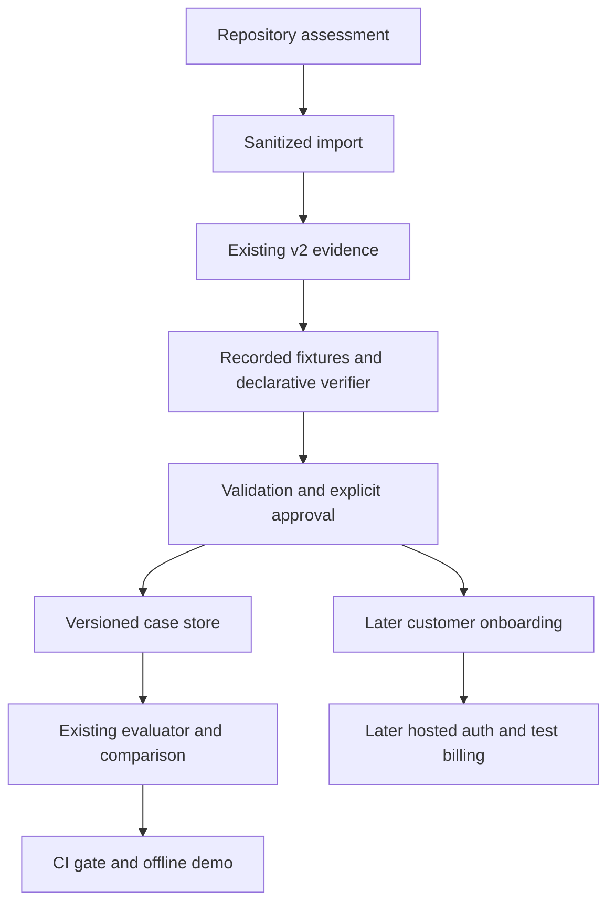

# Commercial MVP plan and implementation checklist

Goal: one failed trajectory becomes one approved, validated declarative regression
test that evaluates candidate evidence safely and emits a CI decision. Keep Agent
Benchmark, Evaluation, Replay & Regression as the underlying infrastructure.

## Recommended first three pull requests

1. Assessment and first vertical slice (this change): native/generic/OTLP import,
   exact verifiers with positive/negative validation, recorded fixtures, immutable
   case version and approval, existing candidate-evidence runner, bounded project
   quotas, CLI/API and offline CI demonstration. Stack on security PR #3.
2. Customer onboarding: improve the existing failure-first UI, export approved
   suites into customer repositories, test one real framework adapter with design
   partners, measure first-test/first-CI time and improve errors. No custom execution
   environment per customer.
3. Hosted pilot foundation after operator approval: managed authentication,
   organization/project/invite lifecycle, scoped/revocable API keys, durable
   transactional usage ledger and Stripe test-mode checkout/webhooks. Review actual
   hosted API/storage requirements before selecting a migration. Live billing and
   production release require separate explicit authorization.

## File-level implementation plan

| Files | Work | Reuse |
| --- | --- | --- |
| guard/imports.py | Bounded native/generic/OTLP normalization, privacy and identity | contracts, migrations, sanitizer |
| guard/generator.py | Recorded fixtures, draft rules, positive/negative validation | cases.create, assertions.evaluate, ToolInterceptor |
| guard/store.py | Immutable versions, approval binding, project usage caps | storage.save/read/within, serialization.digest |
| guard/runner.py | Candidate identity/input checks, gate aggregation | regression.run_case, comparison, regression reports |
| guard/cli.py, guard/demo.py | Explicit commands and synthetic A/B scenario | existing capture and CLI dispatch |
| regression/assertions.py, regression/predicates.py | Bounded declarative schema/order/predicate support | existing assertion engine |
| regression/runner.py | Generated cases require valid approval even through legacy test command | existing evidence path |
| server.py, security/access.py | Existing tenant API routes and reviewer permission | server-derived org identity and audit |
| cli.py, scripts/generate_schemas.py | Add guard dispatcher and additive schemas | all existing commands |
| tests/test_guard*.py | Imports, verifier validity, approval, quotas, HTTP isolation and CI exits | existing offline tests |
| .github/workflows/regression-guard.yml | Offline demo and sample gate | GitHub Actions; contents: read |
| docs/productization, docs/operations, README | Honest limits and onboarding | current deployment and security docs |

## Dependency graph

## Prioritized checklist

- [x] Phase 0: inspect actual branch state, architecture and safety constraints.
- [ ] P0: reject invalid/oversized imports before any persistence; scope by principal.
- [ ] P0: three file formats and explicit missing-history limitations.
- [ ] P0: build fixtures and require supplied expected outcome plus positive evidence.
- [ ] P0: validate declarative rules; incomplete drafts cannot be approved or block.
- [ ] P0: bind approval to immutable case/source/fixture/validation versions.
- [ ] P0: use recorded playback for inspection and captured candidates for evaluation.
- [ ] P0: persist reports, versions, task classification and blocking exit codes.
- [ ] P0: bound imports, cases, runs, bytes, steps; no model calls or retry loop.
- [ ] P0: automated synthetic end-to-end demo and GitHub Actions result.
- [ ] P1: customer-facing approval workflow and suite management UI.
- [ ] P1: self-service auth, invites, project access, key rotation and revocation.
- [ ] P1: Stripe test billing and server-derived entitlements; live payments disabled.
- [ ] P1: hosted health/error alerts, restore drill, per-record retention and encryption.
- [ ] Business P0: ten interviews, three design partners, two paid continuations.

## Database migration and rollback

This slice adds a guard/ directory under each existing tenant/project root. Existing
trajectory, case, benchmark and rollout SQLite schemas stay unchanged. Legacy files
are not silently assigned to an organization. Versioned cases remain regression
case v1 with additive guard metadata. Approval records are separate and checksum
bound. New verifier operators are additive; older clients cannot evaluate them.

Later SaaS metadata migration: select one managed transactional store for accounts,
memberships, keys, usage, subscriptions and entitlement events. Keep trajectory
references/content hashes rather than duplicate trajectory bodies. Backfill via
explicit sanitized import, test row-level tenant enforcement, and keep read-only
source backups through a defined operator retention window. This is a plan, not an
implemented SQL migration.

Rollback: stop requests/jobs, preserve sanitized artifacts and approval history,
restore the previous package/branch and point static Vercel deployment at its
previous tested build. Old versions cannot enforce new guard approvals; do not use
them to evaluate generated suites. Disable those routes/suites during rollback.
Never roll back privacy/replay protection to enable host execution.

## Test strategy

Run focused tests after import/store, generator, evaluator/API and demo stages.
Persisted canaries must be absent from every artifact. Test malformed JSON,
unsupported types, parent cycles, missing OTLP payloads, oversized inputs, unsafe
paths, duplicate identities, redacted mocks and unavailable evidence. Approval must
fail after source/rule/fixture/validation changes. Test positive/negative rule
discrimination, missing candidate version, different task input, playback evidence,
unknown tools and critical INCONCLUSIVE. Exercise real HTTP roles and two tenants.
Check usage caps before writes and idempotent repeated imports. Run the full existing
Python/JS suites and distribution check, then installed CLI demo and remote CI.

## Operational complexity and cost model

This slice: one operator-owned loopback process, local JSON artifacts, no cloud jobs,
models or billing. Existing Vercel static arrangement stays unchanged. It is not a
commercial multi-instance backend and has no uptime SLA.

Illustrative planning budget, **not vendor quotes or measured production cost**:
one API instance $25–60/month, managed auth/metadata $0–50, storage/backups $5–20,
error alerts $0–25. Shared fixed envelope $30–155/month. At ten customers that is
$3–15.50/customer before support, CI compute, taxes/payment fees and model usage.
Customers run CI compute in their own accounts. This milestone makes zero model
calls. Measure bytes and executions before enabling model reruns or setting tier
limits. Assumed import CPU 50 ms, generation 100 ms, evaluation 200 ms are capacity
inputs to validate, not benchmarks. At 1 vCPU, 1,000 of each operation implies
350 CPU seconds before HTTP/storage overhead.

Operational target: one deployment, shared configuration, bounded jobs, automated
support docs and restore rehearsal. Five to ten hours/week is a design goal. Track
support minutes and incidents; do not offer mandatory 24/7 or per-customer branches.
Revenue arithmetic: about 11 Team accounts at $799/month gives $105,468 ARR; about
32 gives $306,816 ARR before churn/discounts. These are targets, not forecasts.
