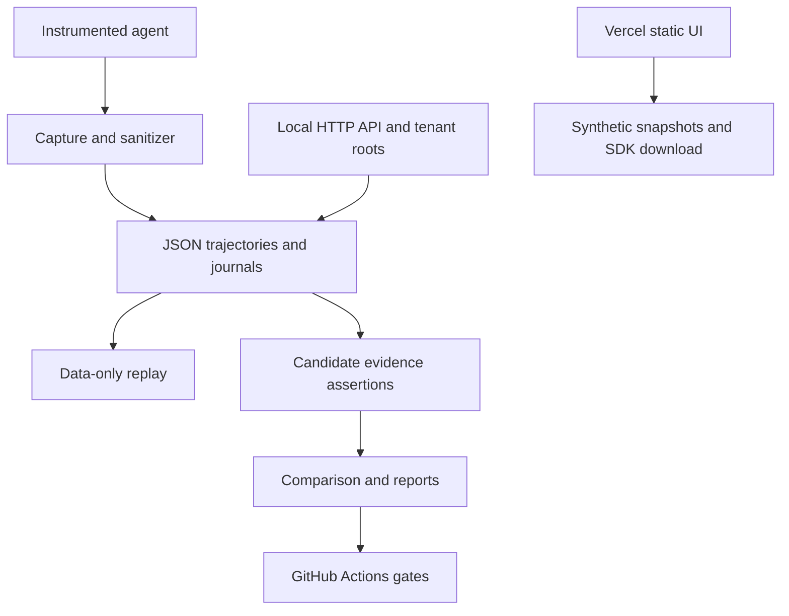
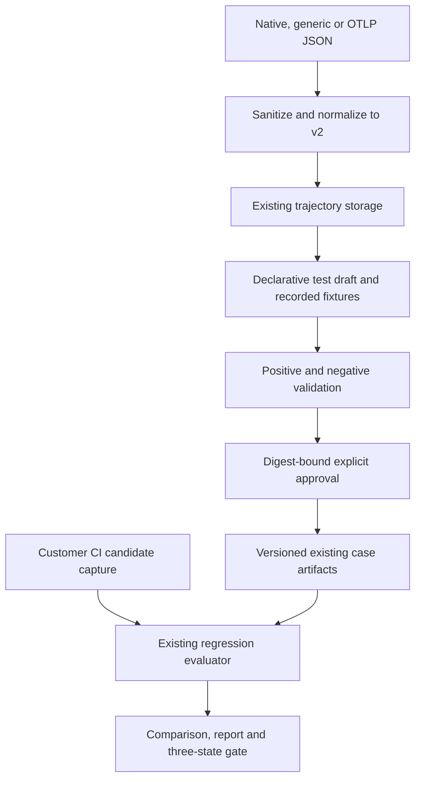

# Agent Regression Guard: repository assessment

Assessed 2026-10-11 before implementation. Main is `6c9fa59`; the reusable
benchmark implementation is open PR #2 (`f8c43e6`), and the tested privacy/reliability
foundation is open PR #3 (`b5016bf`). This slice is stacked on PR #3, not a claim
that those features are already on main. All 307 source blobs in that foundation
were checked against their GitHub blob hashes. No AGENTS.md was present.

## Capability matrix

COMPLETE means reusable for this narrow slice, not generally enterprise complete.

| Capability | Status | Evidence and action |
| --- | --- | --- |
| Agent runtime | PARTIAL | runtime/runner.py deliberately rejects host execution; reuse candidate evidence path in regression/runner.py |
| Trajectory capture | COMPLETE | capture.py, journal.py support sync/async spans, relationships and durable sanitized capture |
| Trajectory v2 | COMPLETE | contracts.py, migrations.py and schema/; keep these canonical formats |
| Trajectory storage | PARTIAL | storage.py atomic JSON; no hosted database, transactional tenant catalog or user accounts |
| Safe replay | COMPLETE | security/replay.py has data-only playback and recorded ToolInterceptor; no executable sandbox |
| Model rerun | DEFER | No isolated provider capability; leave disabled |
| Benchmark adapters | COMPLETE | benchmark/adapters/local.py and offline agents; remote benchmark integrations are not implemented |
| Evaluation | PARTIAL | Business assertions, verifiers and metrics exist; add bounded declarative schema/order/predicate rules to the same assertion engine |
| Failure detection | PARTIAL | execution errors and explicit failures exist; normalize imported classifications, do not infer success from tool completion |
| Failure clustering | DEFER | No production clustering in this branch; risk-model PR #1 is separate experimental work |
| Scenario mutation | DEFER | Fixture variants are not a validated scenario mutation pipeline |
| Verifier generation | MISSING | cases.create produces an empty draft; requires positive/negative validation and approval binding |
| Regression comparison | COMPLETE | comparison/ structural diffs and benchmark task-level comparisons |
| CI | PARTIAL | Seven existing Actions workflows; no customer-ready failure-to-test onboarding example |
| Authentication | PARTIAL | Loopback session token and opt-in server-configured hashed pilot identities, not self-service login |
| Organizations | PARTIAL | Tenant roots and ADMIN/DEVELOPER/VIEWER authorization; no signup/invites/projects lifecycle |
| APIs | PARTIAL | /api/v1 conventions, size bounds, imports, jobs, reports; no generated-case lifecycle API |
| Frontend | PARTIAL | Existing failure/compare/regression pages; no approved generated test workflow, billing or usage UI |
| Database | DEFER | File storage for evaluation, SQLite for separate rollout controller; no PostgreSQL/RLS to migrate |
| Hosting | PARTIAL | Vercel hosts dist/ and downloadable SDK at b5016bf; Python API is loopback, not a hosted SaaS |
| Observability | PARTIAL | Rollout metrics, persisted jobs/audit; no hosted error monitor/alerts/restore drill |
| Billing | MISSING | No Stripe checkout, portal, webhook or entitlement ledger |
| Quotas | MISSING | Payload/step/time limits exist, no commercial usage entitlements |

## Current architecture

Rollout/training use a separate SQLite controller and optional workers. They remain
available but are not the commercial product's execution or tenant boundary.

## Proposed incremental architecture

No queue, new database, application framework or hosted execution environment is
needed for this demonstration. It will not be described as a self-service SaaS.

## External adapter decision

Select file-based OTLP JSON as the single external format. Decode resourceSpans,
scopeSpans, span IDs, parents, timestamps and attributes. OTLP does not guarantee
agent inputs/outputs: missing payloads remain unsupported, never invented. Support
an explicit documented attribute mapping and one trace per import; reject partial
parents, duplicate IDs and mixed traces. Langfuse, LangSmith and provider-specific
SDK integrations remain planned. References: [OTLP JSON](https://opentelemetry.io/docs/specs/otlp/#json-protobuf-encoding)
and [trace protobuf](https://github.com/open-telemetry/opentelemetry-proto/blob/main/opentelemetry/proto/trace/v1/trace.proto).

## Gaps and risks

The first commercial risk is demand, not distributed execution throughput. Missing
positive examples and unreliable customer success criteria may prevent generating
useful verifiers. A validated example pair establishes discrimination on that pair,
not a calibrated confidence probability or general correctness.

The current host runtime is intentionally unavailable. Recorded playback cannot
prove a new version works. Candidate capture provenance is customer-supplied
evidence, not a cryptographic proof of trustworthy execution. CI remains trusted
to produce honest evidence. Hosted arbitrary-code execution requires a separate
security design before implementation.

Static hosting must not be mistaken for a deployed tenant API. Unknown opaque
secrets need configured fields; historical raw traces require explicit sanitized
migration. Local audit is not tamper-proof. Shared file storage supports one
controller, not multi-instance writers. Unbounded audit retention and direct OS
administrators are outside the new project quota boundary.

No customer interviews, paid pilots, conversion data, Stripe account readiness,
SOC 2 certification, or product-market fit is established by this assessment.
