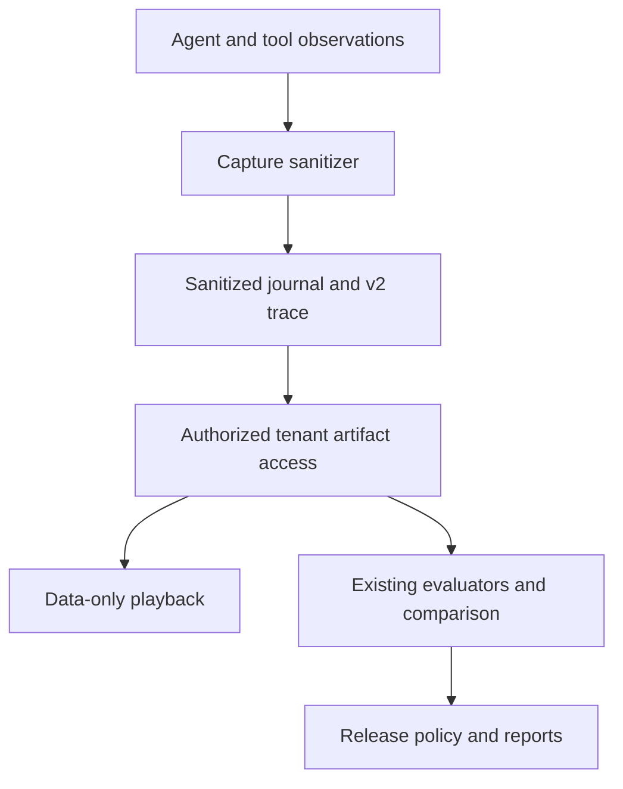

# Security data flow

Capture occurs during actual application execution; it does not grant permission
for, suppress or isolate production actions. The privacy layer transforms copies
of captured data while returning original application values to callers.

Structured keys include credentials, authorization/cookies, environment credential
names, header name/value pairs and configured sensitive fields. JSON-encoded tool
arguments are parsed recursively. Text patterns cover supported key formats,
authorization values, private-key blocks and credential assignments. STRICT also
masks known PII fields, email patterns and SSN patterns; STANDARD/CUSTOM retain
mandatory credential protection. Generic unrestricted opaque PII detection is not
implemented.

Malformed structured text, cycles, recursion limits, unsupported objects and failed
object conversion produce a fixed failure marker. Custom redactor errors never
include the original exception message in sanitizer warnings. Metadata marks failed
sanitization and replay limitations; value envelopes are downgraded to redacted or
unsupported. Paths are sanitized before findings are recorded.

Storage, import, export, server responses and human-readable reports sanitize again
as defense in depth. Export recomputes bundle checksums over sanitized bytes instead
of copying raw source bytes. Trajectory hashes and accepted regression evidence
must be created after this transformation. The model-provider request transport is
not the capture sink: explicit production model calls still need their real input.

Organization bearer credentials are control-plane credentials and are never put
in trajectories or audit bodies. Existing local desktop session-token bootstrap
is intentionally exempt from response redaction; organization health endpoints do
not disclose a session token.

Audit contains principal, organization, action/path, time and outcome only. No raw
request body or execution log is copied to audit. Local UI imports require the server
sanitizer before adding evidence to the displayed workspace. Legacy browser import
is disabled in favor of the existing modern debugger.
