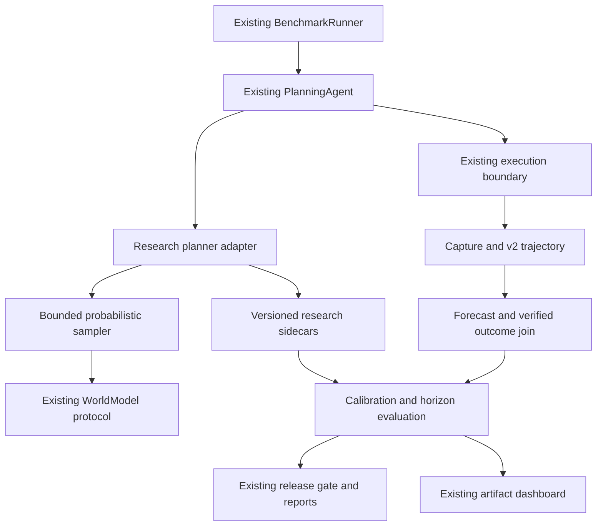

# v0.6 repository audit and incremental implementation plan

Audited 2026-10-18 against local `ab2fe6f` (v0.5 branch). Source, not README
claims, is authoritative. This is a CPU-only reliability research extension;
no production deployment, model download, paid inference or online training.

## Architecture inventory

| Capability | Actual reusable paths | Status and extension |
| --- | --- | --- |
| Agent execution | `planning/core.py` PlanningAgent; `runtime/runner.py` | Reuse authorized snapshot/execution and irreversible-operation protection; host executable replay remains disabled |
| Benchmark lifecycle | `benchmark/{adapter,runner,contracts,store}.py` | Reuse task IDs, Capture, v2, results, deadlines, RunStore and summaries |
| World model | `planning/{interfaces,contracts,models}.py`, `world_model/interfaces.py` | Reuse predict(context, action, config), typed distributions, provenance, copied hypothetical state |
| Imagination | `planning/core.py` Planner | Reuse distribution sampling primitive; online limits H<=8, M<=8 and record caps preserved |
| Calibration | `planning/{metrics,calibration}.py` | Existing Brier/fixed ECE/AUC/AP, histogram calibration and bootstrap; missing typed temporal joins, Platt/isotonic, grouped statistics and leakage-safe research protocol |
| Prediction errors | `planning/evaluation.py`, `world_model/evaluation.py` | Reuse structured comparisons and real step references; numeric errors never applied to text |
| Dataset / training | `world_model/{dataset,training,local,registry}.py` | Grouped JSONL, CPU categorical training, optional HF/LoRA, offline promotion. CPU smoke tested previously; no GPU/provider quality claim |
| Regression / gate | `benchmark/{compare,release,reports}.py`, `planning/gates.py` | Reuse paired task comparison, PASS/FAIL/INCONCLUSIVE, reports and exit status; add optional probabilistic policy |
| Capture / privacy | `capture.py`, `storage.py`, `security/{sanitizer,replay}.py` | Sanitization before atomic persistence; recorded replay data-only, no new executor |
| Rollout workers | `rollout/{store,async_runner,executors,grpo,torch_learner}.py` | Existing SQLite/process/Ray and optional DDP experiments; not needed for bounded CPU research |
| UI / API | `dist/{world-model,planning}.js`, `server.py`, `saas/server.mjs` | Extend existing local artifact viewer, not a second UI/runtime or public research execution API |
| CI | `.github/workflows/*.yml`, `tests/` | Existing unittest/Node/Playwright and optional training CI; add offline research evidence job |

Paths above are relative to `sdk/agent_replay/` except explicit dist/docs/tests.
Base package has no runtime dependencies. Python dataclasses + unittest, JSON/JSONL
atomic files; Node static UI and SaaS controllers. No ORM migration required.

## Missing versus validated

Missing: calibration forecast/outcome schemas and temporal joins; task-group split
manifests; Platt and PAVA isotonic fitting; CVaR/four planner comparison; structured
horizon protocol separation and adaptive replan analysis; unified experiment
provenance; research views; paired probabilistic CI extension.
Existing v0.5 deterministic/CPU evidence does not establish calibrated forecast
quality or world-model superiority over a safe rule policy. Optional GPU inference,
production-scale distributed training and external provider prediction quality
remain unvalidated and outside the CPU acceptance path.

## Proposed architecture and file-level map

1. `probabilistic/calibration/{schemas,collector,metrics,calibrators,evaluator}.py`:
   typed forecasts, before-outcome joins, held-out fitting and diagnostics; reuse
   existing probability metric definitions rather than alter their old outputs.
2. `probabilistic/planning/{risk_metrics,rollout_sampler,risk_aware_planner}.py`:
   bounded sampler over copied AgentContext and WorldModel; compatible planner
   sessions consumed by existing PlanningAgent; full simulated futures in sidecars.
3. `probabilistic/horizon/{prediction_error,replanning_policy,reliability_analyzer}.py`:
   explicit teacher-forced/free-running/closed-loop protocols, cached plans and
   observation-only triggers, numeric state and categorical terminal metrics.
4. `probabilistic/experiments/{config,statistics,domain,runner,reporting}.py`:
   independent synthetic stochastic workflow adapter, existing benchmark execution,
   reproducible seed screening, provenance, grouped paired comparisons and reports.
5. `probabilistic/gates.py`, `benchmark/release.py`, `cli.py`: additive opt-in gate
   and CLI; explicit baseline version, missing evidence inconclusive, existing gates
   preserved. `dist/world-model.{html,js}` adds three local artifact views.
6. `examples/probabilistic/*.json`, `tests/test_probabilistic*.py`, Node UI tests,
   `.github/workflows/probabilistic.yml`, README and measured validation report.

## Schema / migration decision

Keep trajectory v2, benchmark-run.v1, existing PlanningConfig caps and APIs. Add
versioned `research-experiment.v1`, `success-forecast.v1`, `verified-outcome.v1`,
`probabilistic-rollouts.v1`, `research-evidence.v1` associated JSON artifacts. IDs
link run/task/trajectory/real step and source planning session. Embed only compact
root predictions and score summaries in existing planning-session.v1; H=32/M=32
futures are sidecar records with hashes, never new real tool steps. No complete
trajectory copies. No SQL or destructive migration. Published aggregates omit
raw observations, credentials, task payloads, internal paths and identifiers.

## Dependencies and execution checklist

- [ ] Audit / ADR (this document) before code.
- [ ] Calibration schemas -> strict join -> grouped metrics -> held-out fit -> tests.
- [ ] Pure copied-state sampling -> fractional-tail CVaR -> four selectors -> tests.
- [ ] Research planner session adapter -> existing PlanningAgent -> controlled
      benchmark adapter -> persisted real outcomes and recorded replay tests.
- [ ] Cached-plan strategies -> real-observation triggers -> separate horizon
      evaluations -> repeated matched seeds and failure analysis.
- [ ] Unified runner / configs -> persisted reports -> opt-in existing gate -> UI.
- [ ] Full old and new suites -> actual experiment outputs -> limitations/release docs.

## Risks and rollback

No arbitrary Python, tool, provider or network callback accepted by research CLI.
Only bundled synthetic dynamics run locally. Models receive copies, never an
executor. Stored predictions are simulated-only; labels require real verifiers.
Repeated trials are clustered by scenario, not treated as independent task labels.
Data shift, rare-tail undersampling, ECE binning, bootstrap small-sample behavior,
and synthetic-only external validity remain material limits. Minimum samples and
confidence intervals can yield INCONCLUSIVE; no production gate based on a small
favorable seed. Limits bound tasks, seeds, horizon, samples, model calls, wall time
and artifact size. Full factorial sweeps are not an automatic default.

Rollback: disable research policies/feature, retain prior v0.5 package and immutable
artifacts. Additive files can coexist; no production database rollback is necessary.
