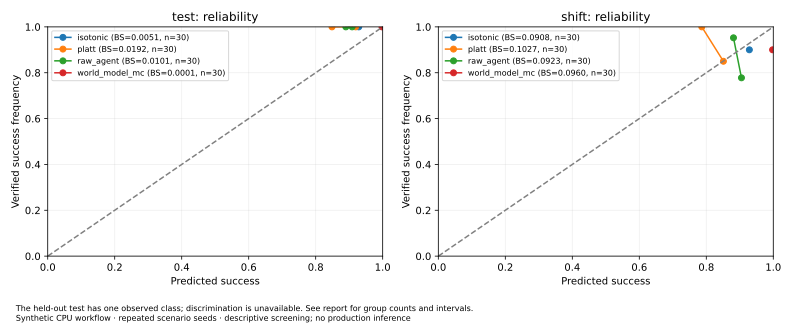
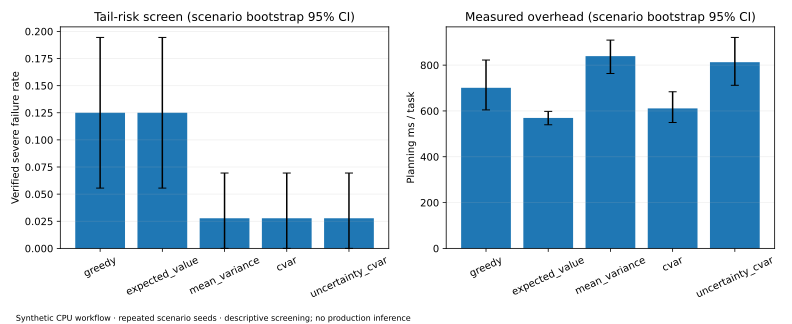
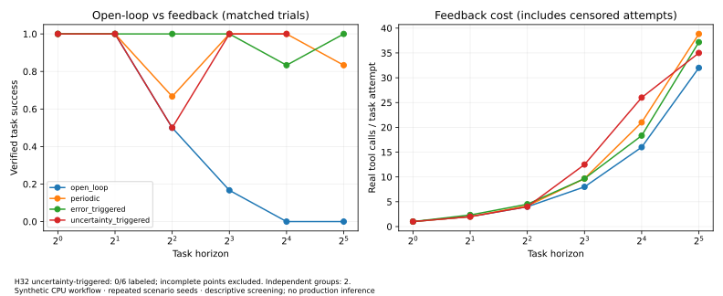

# v0.6 implementation and validation report

Validated 2026-10-18. This is an optional CPU reliability **research preview** on
Agent Regression Guard / Agent Benchmark, Evaluation, Replay & Regression.
It is not production calibration certification or a general autonomous agent.

## Implemented and reused

| Area | Added / modified paths | Reused boundary |
| --- | --- | --- |
| Forecast evidence | `sdk/agent_replay/probabilistic/calibration/{schemas,collector}.py` | Stable benchmark/run/task/trajectory IDs, real verifier labels, sanitized JSON storage |
| Calibration | `calibration/{calibrators,metrics,evaluator}.py` | Existing Brier/ECE/AUC/AP definitions; adds task grouping, log loss, PAVA/Platt, slope/intercept, selective coverage |
| Risk planning | `probabilistic/planning/{rollout_sampler,risk_metrics,risk_aware_planner}.py` | Existing CandidateAction/AgentContext/WorldModel and PlanningAgent; generic injected generators, no second executor |
| Horizon / feedback | `probabilistic/horizon/{prediction_error,replanning_policy,reliability_analyzer}.py` | Copied hypothetical state, real observed state, existing execution authorization and recorded replay |
| Experiments | `probabilistic/experiments/{config,domain,runner,statistics,reporting,failure_analysis}.py` | BenchmarkRunner, RunStore, v2 Capture, independent in-memory environment and evaluator |
| Gates | `probabilistic/gates.py`, `benchmark/release.py` | Existing PASS/FAIL/INCONCLUSIVE, replay checks, exit codes and benchmark comparison |
| Capture correctness | `capture.py`, `provenance.py` | Finalize interrupted child spans on close; record correct SDK version, tree/diff identifiers without raw patches |
| UI | `dist/{world-model.html,world-model.js,reliability.js,reliability-summary.json}` | Existing static workspace; local-only artifact import and three Labs |
| CLI / artifacts | `cli.py`, `probabilistic/cli.py`, two associated JSON schemas, examples, packaging | Existing CLI commands, trajectory v2, benchmark-run.v1, plugin SDK and source ZIP |
| Validation | Three `test_probabilistic_*.py`, `test_sdk.py`, `reliability.test.mjs`, existing browser flow, new workflow | unittest, Node, Playwright, existing GitHub Actions; no API keys |

No SQL migration, new database, scheduler, mandatory dependency or frontend rewrite.
The schema additions are versioned associated JSON, not incompatible trajectories.
Only bundled synthetic workloads are executable through the research CLI; arbitrary
trusted SDK callbacks are not advertised as an OS sandbox.

## Actual calibration experiment

60 scenario groups, three environment seeds per group: **180 real in-memory task
executions**. Families 0–2 fit calibration (90 rows / 30 groups); family 3 validates,
family 4 tests, family 5 evaluates environment distribution shift (30 rows / 10
groups each). All forecasts precede the first actual action and verified outcome.
Platt and isotonic use training only; no favorable test model is selected.

| Split | Method | Labels / independent groups | Brier | Log loss | ECE | AUROC |
| --- | --- | --- | --- | --- | --- | --- |
| test | isotonic | 30 / 10 | 0.005102 | 0.074108 | 0.071429 | unavailable |
| test | platt | 30 / 10 | 0.019248 | 0.145546 | 0.134845 | unavailable |
| test | raw_agent | 30 / 10 | 0.010140 | 0.105446 | 0.100000 | unavailable |
| test | world_model_mc | 30 / 10 | 0.000130 | 0.002151 | 0.002083 | unavailable |
| shift | isotonic | 30 / 10 | 0.090816 | 0.330603 | 0.028571 | 0.500 |
| shift | platt | 30 / 10 | 0.102738 | 0.372260 | 0.071871 | 0.247 |
| shift | raw_agent | 30 / 10 | 0.092285 | 0.336795 | 0.088000 | 0.247 |
| shift | world_model_mc | 30 / 10 | 0.095964 | 1.934489 | 0.097917 | 0.667 |

The held-out test happened to contain only successful outcomes: AUROC/AP are
unavailable, not zero. A very low MC Brier there does not prove general calibration.
Platt worsened Brier relative to raw confidence. Isotonic improved this particular
positive-only sample, while shift performance remained poor. All calibration
comparisons are inconclusive at the configured independent-group threshold.
Intervals, reliability bins, slope/intercept status and class counts are persisted.
Log loss clips probabilities at epsilon=1e-12; ECE depends on binning.



## Actual risk planning experiment

**18 configurations × 24 scenario groups × three seeds = 1,296 task executions**.
The five main planners use identical candidate sets, K=4, M=16, H=3, independent
real/simulation PRNGs and the same verifier. Other configurations are a declared
one-factor screen, not a full factorial sweep. Task loss CVaR is evaluated at a
fixed alpha=0.9; planning alpha can differ. Rewards and tool prices are synthetic.

| Planner | Passed | Severe failures | Observed task-loss CVaR (alpha=.9) | Reward/task | Planning ms/task | Real tools/task |
| --- | --- | --- | --- | --- | --- | --- |
| greedy | 63/72 | 9/72 | 10.978 | 3.003 | 701.0 | 2.903 |
| expected_value | 63/72 | 9/72 | 10.922 | 2.520 | 569.5 | 3.056 |
| mean_variance | 70/72 | 2/72 | 1.114 | 3.021 | 839.4 | 3.014 |
| cvar | 70/72 | 2/72 | 1.114 | 3.021 | 611.2 | 3.014 |
| uncertainty_cvar | 70/72 | 2/72 | 1.114 | 3.021 | 812.9 | 3.014 |

CVaR versus expected value: severe-rate delta **−9.72 percentage points**;
scenario-cluster 95% interval **[−16.67, −4.17] pp**. The paired randomization test
is **INCONCLUSIVE after Holm correction across the full 85-comparison screen**
(adjusted p=0.600). This is an observed difference, not established general benefit.
Mean–variance matched CVaR outcomes here; the uncertainty term added no benefit.

M=8/16/32 produced 5/2/0 severe failures out of 72 respectively. A model that
underestimates rare failures produced **12/72** severe failures with CVaR. These
are useful descriptive ablations. H1 and H3 remain statistically inconclusive after
multiplicity correction. H2 is not established: this screen measures decision
outcomes, not risk-estimation error against a held-out probability oracle.
The stored initial forecasts permit additional calibration analysis without
re-executing tools. The no-world-model safe-rule control from v0.5 remains available;
these results do not establish superiority over that control.

Candidate scores, sampled futures, tail sample mass, seeds, model versions, outcome
references and failure diagnostics are stored. Real outcomes are never assigned to
unexecuted alternative actions. The descriptive Pareto front trades success,
severe failure, local latency and synthetic cost; it is not a significance claim.



## Actual horizon screen

**24 configurations × two scenario groups × three seeds = 144 task executions**,
H=1/2/4/8/16/32, K=2, M=4. Every policy at each horizon has the same task definitions,
environment seeds, verifier and execution limits. With only two independent groups,
all policy comparisons are **INCONCLUSIVE**, including favorable success differences.

| H | Policy | Verified success rate | Labeled / tasks | Real tools/task attempt | Planning ms/task | End-to-end ms/task attempt |
| --- | --- | --- | --- | --- | --- | --- |
| 16 | open_loop | 0.0% | 6/6 | 16.00 | 481.9 | 940.7 |
| 16 | periodic | 100.0% | 6/6 | 21.00 | 3171.5 | 3916.7 |
| 16 | error_triggered | 83.3% | 6/6 | 18.33 | 1891.7 | 2506.7 |
| 16 | uncertainty_triggered | 100.0% | 6/6 | 26.00 | 8052.0 | 9231.1 |
| 32 | open_loop | 0.0% | 6/6 | 32.00 | 1048.5 | 2115.9 |
| 32 | periodic | 83.3% | 6/6 | 38.83 | 10621.3 | 12100.4 |
| 32 | error_triggered | 100.0% | 6/6 | 37.17 | 10023.0 | 11959.3 |
| 32 | uncertainty_triggered | INCONCLUSIVE | 0/6 | 35.00 | partial lower bound | 26764.6 |

At H=32, uncertainty-triggered replanning exhausted the preserved **512 KiB embedded
planning-record budget** in all six trials. These are **censored**, not six ordinary
failures or successful tasks. The dashboard excludes their success rate from the
curve and marks partial telemetry. End-to-end elapsed time and real executed tool
counts are observed; retained-session planning time is a lower bound when the last
planning session cannot be embedded. Do not infer cost per completed task from
these attempts. Dataset/forecast joins and release gates retain missingness.

Teacher-forced one-step, free-running open-loop and closed-loop protocols have
separate aggregates. Numeric state MAE/RMSE/CRPS and binary success-by-horizon
probabilities have explicit labels and sample counts. Action-mismatched future
windows are excluded as whole distributions, never filtered for favorable samples.
Terminal states are absorbing. Replan thresholds and false/missed trigger labels
are synthetic screening diagnostics, not validated production drift detectors.

An earlier larger horizon stress attempt (six groups, M=8) was interrupted after a
censored H=16 trial exposed a coordinator missing-cost comparison bug. That bug was
fixed; the original interrupted evidence is retained and **not mixed into this
complete screening experiment**. No interrupted run was relabeled completed.



## Safety, replay and quality gates actually exercised

* Root H=32 failure replay used existing recorded playback: **0 external operations,
  0 model calls**; verdict remains `not_evaluated`. Playback is not a new agent test.
* Generic counter-model integration verifies that the planner does not require
  workflow-specific state or schemas. Injected generators still validate actions;
  models receive copies without an executor. Prompt-like observation text cannot
  invoke a tool through the bundled simulator.
* Unknown probabilities, malformed actions, timeouts, exhausted budgets, invalid
  timestamps, duplicate/mismatched labels and train/test overlap are rejected.
* The actual 72-task baseline/candidate release policy with minimum 200 labels
  returned **INCONCLUSIVE, blocking=true, exit 3**. A self-comparison control with
  sufficient declared coverage returned **PASS, exit 0**. Known adverse metric
  effects exercise FAIL in unit tests; no synthetic test is called a live release.
* CI uses normal pull requests, `contents: read`, no provider keys or privileged
  fork execution. Existing benchmark, Guard, SaaS/auth, replay and rollout workflows
  are preserved. No production deployment, billing activation or paid inference.

GitHub's Python 3.14 test exposed a pending child span after timeout. Capture now
marks unfinished children as interrupted errors before persistence and safely
handles late async cleanup. A deterministic test covers the boundary. Replayed
interrupted steps no longer report `running`. This intentionally tightens the
semantics of incomplete captures; normal completed trajectories retain their API.

## Tests and packaging executed

| Validation | Actual result |
| --- | --- |
| Python unittest discovery | 172 passed, including existing core and new research cases |
| Web Node tests | 15 passed |
| SaaS Node tests | 13 passed |
| Playwright existing product/research flows | 2 passed; desktop/mobile, viewer access and XSS |
| Python wheel + sdist | Built successfully |
| SDK web / plugin vendor / deterministic ZIP sync | Checked with package_release.py --check |
| GitHub Actions | Existing 12-workflow set passed at the timeout-fix head; final head status is linked from PR #9 |

Optional existing CPU LoRA/DDP/process/Ray checks run in their established CI jobs.
This report makes no new GPU, CUDA, live-provider quality or production-deployment
claim. A successful tiny CPU training smoke does not establish useful predictions.

## Measured resource overhead

| Experiment | Task executions | Elapsed seconds | Peak RSS MiB | Artifact MiB | KiB / task execution |
| --- | --- | --- | --- | --- | --- |
| Calibration | 180 | 79.9 | 62.5 | 37.1 | 210.9 |
| Risk screen | 1296 | 1186.2 | 70.0 | 581.1 | 459.2 |
| Horizon screen | 144 | 522.1 | 66.0 | 169.8 | 1207.5 |

These are Linux process measurements including capture, serialization and reports.
Risk and horizon jobs overlapped on the local host, so timing is descriptive,
not an isolated latency benchmark or SLA. Peak RSS is process high-water usage;
artifact bytes are measured before final presentation artifacts. Model tokens,
external model calls and actual provider spend were zero. Tool cost values are
fixture prices, not actual financial charges. Storage overhead is substantial;
retention/budgets matter. Aggregate publication contains no private raw trajectories.

## Reproduce and inspect

```bash
pip install -e '.[dev]'
agent-replay probabilistic run --experiment calibration --config examples/probabilistic/calibration.json --output .replay/research/calibration
agent-replay probabilistic run --experiment risk_planning --config examples/probabilistic/risk_planning.json --output .replay/research/risk
agent-replay probabilistic run --experiment horizon_reliability --config examples/probabilistic/horizon-screen.json --output .replay/research/horizon
python scripts/analyze_probabilistic.py .replay/research/risk --output .replay/research/risk-analysis
agent-replay probabilistic publish .replay/research/calibration/experiment.json .replay/research/risk-analysis/experiment.json .replay/research/horizon/experiment.json --output .replay/research/public-summary.json
agent-replay probabilistic replay .replay/research/horizon/h32-open_loop horizon-scenario-0-seed-0 --output .replay/research/recorded-replay.json
python -m unittest discover -s tests -p 'test_*.py' -q
```

Use a new output directory; source run/trajectory IDs are retained by read-only
analysis rather than copying full trajectories. `examples/probabilistic/smoke.json`
is the fast offline CI control; it is deliberately too small for research inference.
`horizon.json` is the larger optional stress configuration. Matplotlib is optional
for `scripts/plot_probabilistic.py`; it is not a runtime dependency.

Benchmark results, trajectories and full decision sidecars remain private local
artifacts. Committed `dist/reliability-summary.json` and these SVGs are allowlisted
aggregates from the actual experiments. Forecast records retain versions and
cutoffs; current runs record commit/tree, dirty-state indicators, dependency
fingerprints and Python-source digest. Early exploratory screening began in a
development working tree; its original commit alone is not a complete source
snapshot. Read-only analysis records its own source provenance, and current CLI/CI
runs record the additional digest. UUIDs/timestamps and host timings are not
bitwise reproducible; seeded dynamics and action/observation protocols are.

## Remaining risks and rollback

| Risk / limitation | Consequence / follow-up |
| --- | --- |
| Synthetic domains, scripted policies, small held-out families | No external validity or production-calibrated probability claim; collect larger authorized benchmarks |
| Single-class held-out calibration sample | Cannot assess discrimination there; keep null AUC/AP and report shift separately |
| Shift stratum changes both held-out family and environment | Descriptive shift evidence, not an isolated causal environment-change estimate |
| Two-group horizon screen | Wide/unstable intervals and insufficient evidence; no production release decision |
| Sparse Monte Carlo tails, misspecified models | CVaR may select unsafe-looking futures under a bad model; preserve hard execution policy |
| 999 Monte Carlo sign-randomization draws for larger groups | p-value resolution .001 and low power after large Holm families; increase precision in a prespecified follow-up |
| Record budget / censored long replans | Missing task outcomes and partial planning telemetry; future context deduplication must preserve provenance and privacy |
| Trigger thresholds and failure categories are heuristic | Diagnostic hypotheses only, not causal attribution or validated alarms |
| Large source artifacts and local resource contention | Bounded jobs/retention required; benchmark isolated overhead before hosted execution |
| Trusted SDK predictor callbacks | Not an isolation boundary; hosted APIs do not accept arbitrary callbacks or code |
| No live/GPU experiment in v0.6 evidence | Those remain optional, separately authorized and unvalidated |

Rollback is opt-out: remove the optional probabilistic policy/config and use the
prior planning/baseline path. No database downgrade is needed. Keep immutable
artifacts for audit. Candidate case approval, tenant boundaries, existing replay
restrictions and normal CI gates are unchanged. Follow-up work should increase
independent evaluation coverage and validate estimators before any production gate.
